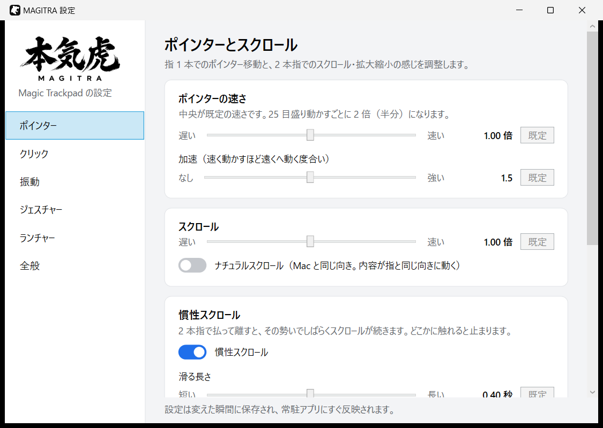
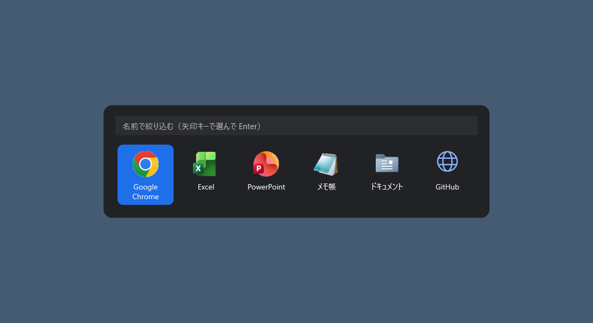

# MAGITRA

Apple の Magic Trackpad を、Windows で Mac に近い使い心地で使うための常駐アプリとツール群です。
USB でつないだトラックパッドから指ごとの位置と圧力を直接読み取り、ポインター・スクロール・ジェスチャー・Force Touch・振動を自前で作ります。

> **English summary** — MAGITRA is a Windows companion for Apple's Magic Trackpad (USB). It binds Microsoft's signed WinUSB
> driver to the trackpad's multitouch interface, reads raw per-finger frames in user mode, and synthesizes pointer, scrolling
> (with inertia), pinch-to-zoom, 3/4-finger gestures, Force Touch with haptic feedback, and a gesture-launched app launcher.
> No custom kernel driver or test-signing mode is required. Bluetooth is not supported. The UI and documentation are in Japanese.
> License: MIT (the logo is excluded).

  
  

## できること

- **ポインターとスクロール**: 加速付きのポインター、ナチュラルスクロール、2 本指で払うと続く慣性スクロール
- **ピンチとダブルタップ**: 2 本指で拡大・縮小（Ctrl + ホイール）、2 本指のダブルタップで拡大率を戻す
- **Force Touch**: 強く押し込むと重い振動を返し、割り当てた操作（既定は中クリック）を送る。振動の強さ・鋭さ・重さを変えられる
- **3・4 本指ジェスチャー**: 仮想デスクトップの切り替え、タスクビュー、デスクトップの表示、アプリの切り替えなど。割り当ては自由
- **ランチャー**: 4 本指で上へ払うと、既定のブラウザーと登録したアプリ・フォルダー・URL の一覧が開く
- **設定画面**: 変えた瞬間に反映される。スライダーごとに既定値へ戻せる
- **ロック画面でも使える**: ロック中・ログオン前は Windows 標準のマウスに自動で戻る（ポインター移動とクリック）
- **管理者権限のウィンドウでも使える**: UIAccess 版を導入すると、タスクマネージャーなどでも操作できる

## 必要なもの

- Windows 10 / 11（x64）
- Magic Trackpad（Lightning の第 3 世代で確認済み。Magic Trackpad 2 と USB-C の第 4 世代は未確認）と、データ通信ができる USB ケーブル
- 導入時の管理者権限

**Bluetooth 接続には対応していません**（Windows のユーザーモードでは指ごとのデータを取り出せないため。[理由](docs/INSTALL.md#できないこと)）。

## 導入

1. [Releases](https://github.com/horiken1216/magitra/releases/latest) から `mtpsetup.exe` をダウンロードする
2. `mtpsetup.exe` を実行し、UIAccess 版か標準版を選ぶ（[導入と取り除き](docs/INSTALL.md)）
3. タスクトレイに虎のアイコンが出たら使える（[使い方](docs/USAGE.md)）

`mtpsetup.exe` には正式なコード署名がないため、実行すると SmartScreen が「Windows によって PC が保護されました」と警告します。
「詳細情報」→「実行」で進めてください。正しいファイルかどうかは、Releases に載せた SHA-256 と
`Get-FileHash mtpsetup.exe` の結果を比べて確かめられます。自分でビルドする場合は [BUILD.md](docs/BUILD.md) を参照してください
（リポジトリのルートで `build.cmd`。Visual Studio 2022 Build Tools と WDK が必要）。

インストーラーは、USB の Magic Trackpad の 1 つのインターフェイス（MI_01）に、Microsoft 署名済みの WinUSB ドライバーを当てます。
署名のために、導入ごとに作る証明書をこの PC で信頼させます（UIAccess 版のみ。秘密鍵は署名後すぐに消します）。
**どちらもセキュリティに関わる変更です。組織が管理する PC では、規定で許されているかを先に確かめてください。**
取り除けば、トラックパッドは Windows 標準のマウスに戻ります。

## 資料

| 資料 | 内容 |
|---|---|
| [docs/INSTALL.md](docs/INSTALL.md) | 導入と取り除き、対応機種、困ったとき、できないこと |
| [docs/USAGE.md](docs/USAGE.md) | 使い方（トレイ、設定画面、指の操作、ランチャー） |
| [docs/BUILD.md](docs/BUILD.md) | ビルドとテスト、フォルダーの構成 |
| [docs/ARCHITECTURE.md](docs/ARCHITECTURE.md) | 仕組みと、そうした理由 |
| [docs/MANUAL-INSTALL.md](docs/MANUAL-INSTALL.md) | インストーラーを使わない手作業の導入（開発・調査用） |
| [docs/research/](docs/research/) | 調査記録（レポート形式、振動、ロック画面の切り替えなど）と Bluetooth の試作 |

## 参考にした資料

コードは流用せず、レポート形式などの事実の確認に使いました。

- [imbushuo/mac-precision-touchpad](https://github.com/imbushuo/mac-precision-touchpad) と、振動レポートの [gist](https://gist.github.com/imbushuo/2d18a9e6f771d0055223a78930a9171c)
- Linux の `hid-magicmouse` ドライバー
- [vitoplantamura/MagicTrackpad2ForWindows PR #63](https://github.com/vitoplantamura/MagicTrackpad2ForWindows/pull/63)（Bluetooth 版の振動レポート）
- LinuxMagicForce（振動の値の上限）

## ライセンス

コードは [MIT ライセンス](LICENSE)です。ロゴとアイコン（`assets/brand/`）は対象外で、[別の条件](assets/brand/README.md)があります。

Apple、Magic Trackpad は Apple Inc. の商標です。このプロジェクトは Apple Inc. とは関係がなく、Apple Inc. が承認・支援するものではありません。
このソフトウェアは無保証です。ドライバーの変更や証明書の信頼は、ご自身の判断で行ってください。
